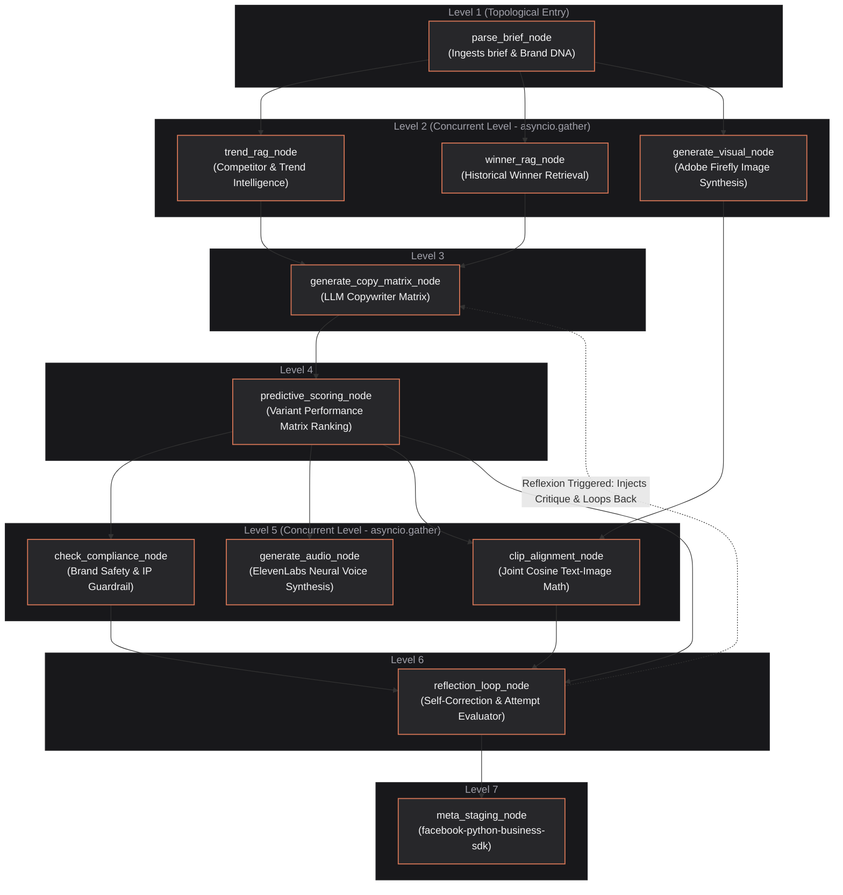

# Pencil AI Marketing OS

A high-performance campaign staging and multi-agent ad creative orchestration platform. Built with a declarative level-by-level parallel DAG scheduling engine, multi-model generation matrix, brand compliance safety gates, predictive scoring, and official Meta Business SDK staging integration.

---

## 1. System Topology Overview



---

## 2. Step-by-Step Execution Lifecycle

Here is the exact next-next-next execution sequence of what happens when a campaign brief is orchestrated:

```
[User Input Brief] 
       │
       ▼
┌────────────────────────────────────────────────────────┐
│ LEVEL 1: parse_brief_node                              │
│ - Ingests product description and brand parameters.    │
│ - Resolves target swatches, typography, and platforms. │
└────────────────────────┬───────────────────────────────┘
                         │
                         ├───────────────────────────────┐
                         ▼                               ▼
┌─────────────────────────────────┐   ┌─────────────────────────────────┐
│ LEVEL 2: trend_rag_node         │   │ LEVEL 2: winner_rag_node         │
│ - Retreives current hook trends │   │ - Fetches historical winners     │
│   from Meta Ad Library.         │   │   from semantic vector index.   │
└────────────────┬────────────────┘   └────────────────┬────────────────┘
                 │                                     │
                 └─────────────────┬───────────────────┘
                                   ▼
┌────────────────────────────────────────────────────────┐
│ LEVEL 3: generate_copy_matrix_node                     │
│ - Generates copy variant options (e.g. 5 matrix angles)│
│ - Synthesizes visual assets in parallel.               │
└────────────────────────┬───────────────────────────────┘
                         │
                         ▼
┌────────────────────────────────────────────────────────┐
│ LEVEL 4: predictive_scoring_node                       │
│ - Scores all copy matrix variants.                     │
│ - Ranks & selects the highest-scoring winning variant.  │
└────────────────────────┬───────────────────────────────┘
                         │
                         ▼
┌────────────────────────────────────────────────────────┐
│ LEVEL 5: check_compliance, clip_alignment, audio_node   │
│ - Evaluates brand rules against the winning variant.    │
│ - Scores visual alignment & generates ElevenLabs TTS.  │
└────────────────────────┬───────────────────────────────┘
                         │
                         ▼
┌────────────────────────────────────────────────────────┐
│ LEVEL 6: reflection_loop_node                          │
│ - Checks if compliance PASSED and score >= 85.         │
│ - [FAIL] Injects critique and loops back to LEVEL 3.   │
│ - [PASS] Proceeds to staging.                          │
└────────────────────────┬───────────────────────────────┘
                         │
                         ▼
┌────────────────────────────────────────────────────────┐
│ LEVEL 7: meta_staging_node                             │
│ - Validates compliance is PASSED.                      │
│ - Stages creative using facebook-python-business-sdk.  │
└────────────────────────────────────────────────────────┘
```

---

## 3. Core Architecture Features

1. **Declarative Topological Sort**: Resolves execution levels at build time and throws validation errors for cyclical structures or missing dependencies.
2. **Concurrent Gather**: Executes independent level tasks in parallel using `asyncio.gather()`. Any blocking synchronous operations run inside `asyncio.to_thread()`.
3. **Reflexion Self-Correction Loop**: Loops back to Level 3 with tailored compliance and score critiques to regenerate creative variations if thresholds are not met.
4. **State Reducers**: Implements isolated delta-only state returns combined with key-specific merge policies (`APPEND` for logs/errors, `REPLACE` for scalars).
5. **SSE Event Bus**: Emits real-time progress events per node to the subscriber queue. Supports a replay buffer to prevent event loss for late-connecting clients.

---

## 4. Setup & Running

### Prerequisites
* Python 3.10+
* Node.js 18+

### Running the Backend
```bash
cd backend
python3 -m pip install -r requirements.txt
python3 -m uvicorn app.main:app --host 0.0.0.0 --port 8000 --reload
```

### Running the Frontend
```bash
cd frontend
npm install
npm run dev
```

### Running Backend Unit & E2E Tests
```bash
DATABASE_URL=sqlite:////tmp/pencil_orchestrator_test.db PYTHONPATH=backend python3 -m unittest discover -s tests/backend
```
`DATABASE_URL` points tests at a separate SQLite file so fixture rows don't leak into the campaign history shown by a locally running dev server (which defaults to `/tmp/pencil_orchestrator.db`).