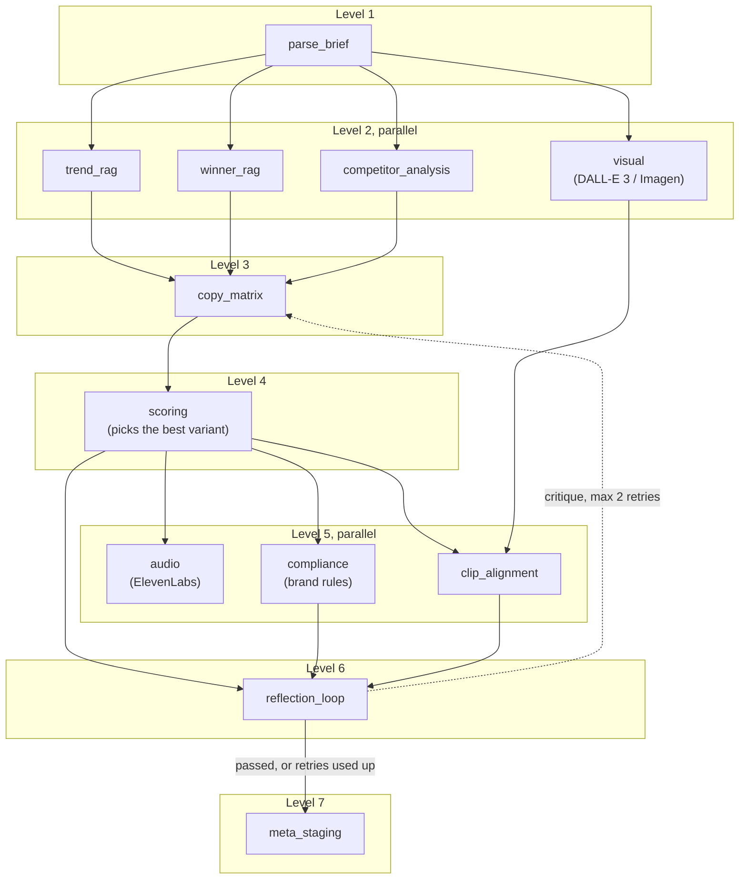

# Pencil AI Marketing OS

<p align="center">
  
  
  
  
  
</p>

Turns a campaign brief into ready-to-stage ads. Agents pull trends and past winning ads, write copy and generate images (DALL-E 3 or Vertex Imagen) in parallel, score the variants, run a brand-safety check, and stage the result as an ad creative through Meta's Graph API.

Paste a competitor's ad and the copy step writes variants that take a different angle, shown side by side in the UI. If the best variant scores under 85 or fails the brand check, the pipeline critiques it and rewrites the copy, up to 2 more times.

## How it works

A small DAG engine (`backend/app/graph/engine.py`) sorts the 12 nodes into levels at build time, rejects cycles and missing dependencies, and runs each level with `asyncio.gather`. Each node declares which state keys it writes; two nodes in one level can't write the same key.



- **Staging gate.** `meta_staging` refuses any variant that failed the brand check, even after the retries run out.
- **Failures.** Each node is marked `ABORT` or `DEGRADE`. If trends, winners, competitor analysis, audio or CLIP alignment fail, the run continues without them; a failure anywhere else stops it.
- **State.** Nodes return only the keys they changed. `execution_steps` and `errors` are appended, everything else is replaced.
- **Progress.** Each node emits an event over SSE. Late clients get a replay buffer so they don't miss earlier steps.
- **Providers.** Every external service has a mock (`backend/app/providers/mocks.py`). With no API keys set, the whole pipeline runs on mocks.

## Run it

Python 3.10+ and Node.js 18+. Copy `backend/.env.example` to `backend/.env` and fill in the keys you have (all optional): `OPENAI_API_KEY`, `GROQ_API_KEY_1`, `GEMINI_API_KEY` or `GOOGLE_CLOUD_PROJECT` for text and images, `ELEVENLABS_API_KEY` for voice, `META_SYSTEM_USER_TOKEN` and `META_AD_ACCOUNT_ID` for staging.

```bash
cd backend
python3 -m pip install -r requirements.txt
python3 -m uvicorn app.main:app --host 0.0.0.0 --port 8000 --reload
```

```bash
cd frontend
npm install
npm run dev
```

**Tests** (34 unit and end-to-end tests under `tests/backend`):

```bash
DATABASE_URL=sqlite:////tmp/pencil_orchestrator_test.db PYTHONPATH=backend python3 -m unittest discover -s tests/backend
```

`DATABASE_URL` points tests at a separate SQLite file so fixture rows don't leak into the campaign history of a local dev server (which defaults to `/tmp/pencil_orchestrator.db`).

## Limitations

From `docs/progress.md`:

- **Scoring is a heuristic**, not a trained model. It adds points for headline words and length.
- **Trend data is sample data.** Meta's Ad Library API only returns political and social-issue ads, so competitor ads come from manual paste instead.
- **Not yet tested against live accounts:** image generation, voiceover, Vertex AI, and Meta staging.
- Screenshot / brand-asset upload and a guided-question onboarding flow are not built yet.
