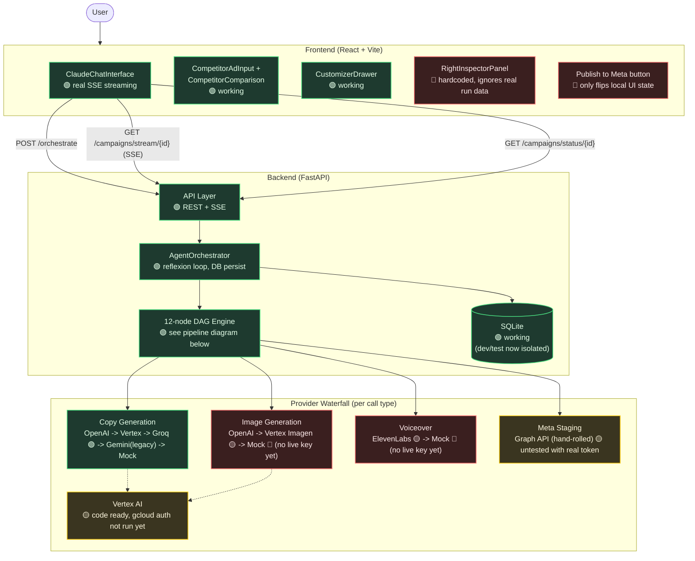
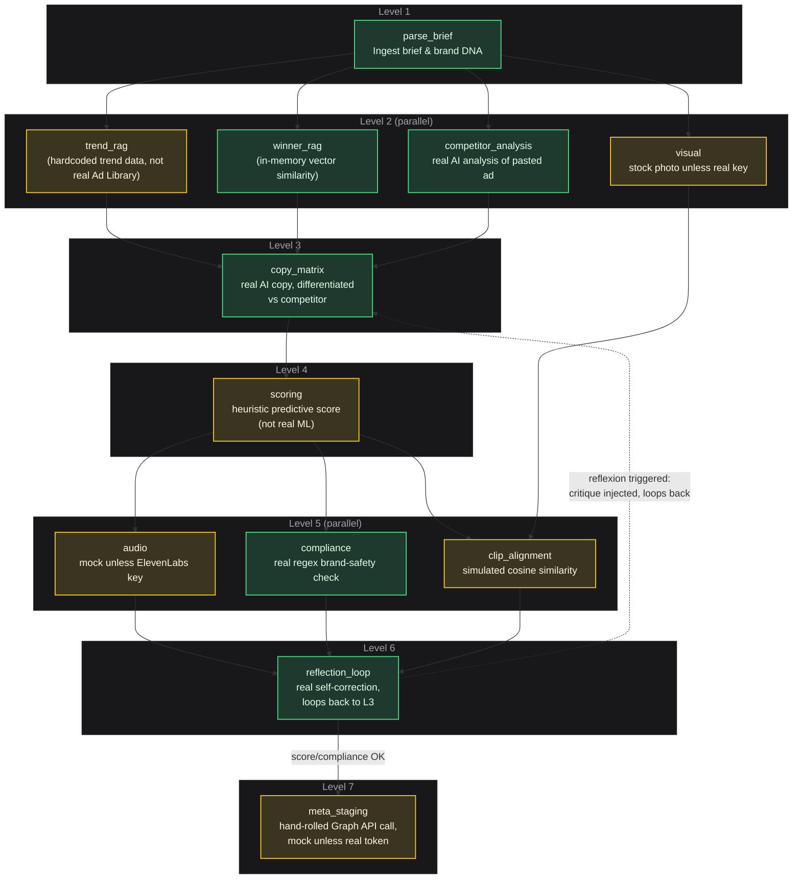
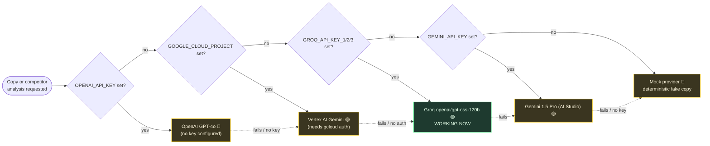

# Pencil AI — Current Architecture & Status

_Snapshot as of this session. Legend: 🟢 real & working · 🟡 built but needs a live key/auth · 🔴 not built / still mocked or fake._

## 1. Status Legend

| Status | Meaning |
|---|---|
| 🟢 | Fully working today, verified live |
| 🟡 | Code exists, needs a credential or manual step you haven't done yet |
| 🔴 | Not built, or currently fake/hardcoded |

---

## 2. System Architecture

---

## 3. DAG Pipeline Topology (backend/app/graph/builder.py)

---

## 4. Provider Fallback Chain (LLM + Competitor Analysis)

---

## 5. Quick Reference: What's Real vs Fake Right Now

| Component | Status | Note |
|---|---|---|
| Chat UI live progress | 🟢 | Real SSE, was 100% fake before this session |
| Competitor ad comparison | 🟢 | Real AI analysis, shapes generated copy |
| Ad copy generation | 🟢 | Real, via Groq |
| Image generation | 🔴 | Stock photos only — no live image key |
| Voiceover audio | 🔴 | Mock only — no ElevenLabs key |
| Predictive score | 🔴 | Keyword heuristic, not ML |
| Trend/competitor RAG | 🔴 | Hardcoded sample data |
| Brand compliance check | 🟢 | Real regex-based rule engine |
| Reflexion self-correction | 🟢 | Real, loops back and retries on failure |
| Meta Ads staging | 🟡 | Real API call shape, untested with live token |
| "Publish to Meta" button | 🔴 | Cosmetic only |
| Right inspector panel | 🔴 | Hardcoded, ignores real data |
| Vertex AI | 🟡 | Code ready, auth step pending |
| Test coverage | 🟢 | 25 tests passing, verified live multiple times |
