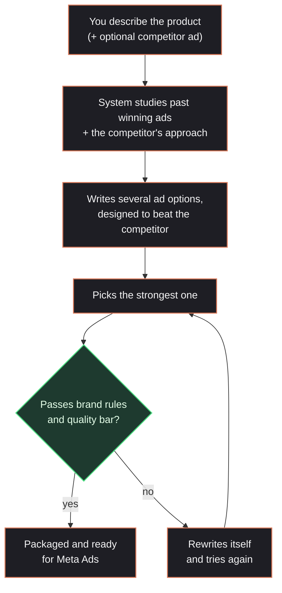

# Pencil AI — Explained in Plain Language

## What this actually does

You give it a product description. It hands back a ready-to-use ad — headline, body copy, an image, and a voiceover script — that's already been checked against your brand rules and scored on how well it's likely to perform. If you give it a competitor's ad, it studies that ad first and deliberately writes something designed to beat it.

Think of it like having a small ad agency team (a copywriter, a brand-compliance reviewer, and a performance analyst) all working on your brief at once, then arguing it out until they agree on the best version — except it takes seconds, not days.

---

## Walking through what happens, step by step

1. **You describe the product** (and optionally paste in a competitor's ad you want to beat).
2. **It does its homework.** It pulls up examples of past ads that performed well, and — if you gave it a competitor's ad — figures out that ad's angle (is it leaning on urgency? a discount? scientific credibility?).
3. **It writes the ad.** Multiple versions, and if there's a competitor ad in play, it writes specifically to differentiate from it rather than just copying the same playbook.
4. **It picks the strongest version** based on a performance score.
5. **It fact-checks itself**: does this break any brand rules (banned words, wrong tone)? Does the image actually match the copy?
6. **If something's wrong, it fixes itself.** This is the interesting part — it doesn't just fail and stop. It figures out what's wrong, rewrites the ad, and checks again. It'll do this a couple of times before either approving the ad or flagging it as blocked.
7. **Once approved, it's packaged up** ready to hand off to Meta Ads.

You can watch all of this happen live — the chat interface shows each step lighting up in real time as it works, instead of just a loading spinner.

---

## The simple picture

---

## What's real right now vs. what's still a placeholder

| Part | Where it stands |
|---|---|
| Writing the ad copy | **Working for real.** It's genuinely generating text with AI, not faking it. |
| Studying a competitor's ad and writing to beat it | **Working for real.** This was the main thing asked for, and it works. |
| Brand rule checking + self-correction | **Working for real.** It actually catches problems and rewrites itself. |
| Watching progress live | **Working for real.** Used to be faked (it just showed a canned animation); now it shows what's actually happening. |
| The product image | **Not real yet.** It's using stock photos as a placeholder — actual image generation isn't connected yet. |
| The voiceover | **Not real yet.** Same situation — placeholder, not connected to a real voice service yet. |
| The "performance score" it gives each ad | **An estimate, not a trained prediction.** It's a reasonable rule-of-thumb scoring system, not something trained on real ad performance data. Worth knowing if anyone asks how the score is calculated. |
| Actually sending the ad to Meta | **Built, but not tested with a real ad account yet.** The wiring is there; it hasn't been proven against a live account. |
| Uploading your own brand images/screenshots | **Not built yet.** Right now you can only type in a competitor's ad text, not upload a screenshot of it. |
| A guided "answer a few questions" setup mode | **Not built yet.** Right now it's one open text box plus some quick-start templates, not a step-by-step questionnaire. |

---

## Bottom line

The core idea — brief in, ad out, automatically checked and self-corrected, and specifically able to out-position a competitor's ad — genuinely works today. What's left is mostly plugging in a couple of paid services (image and voice generation), proving it against a real ad account, and building two extra input options (uploading a screenshot, a guided setup wizard) that weren't started yet.
