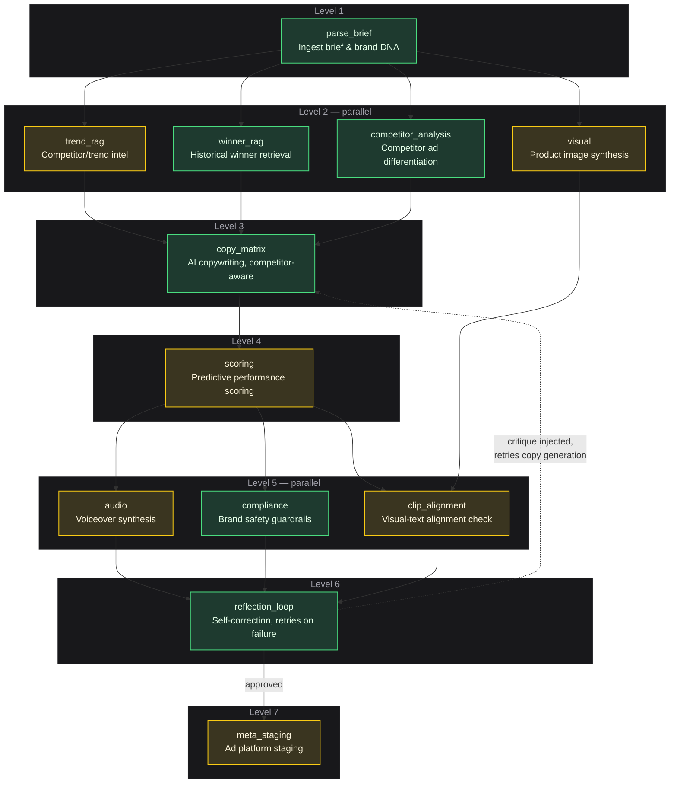

# Pencil AI — Progress Report

**Status: Core pipeline built and validated. Currently in integration & hardening phase.**

The orchestration engine, backend API, and chat UI are functional end-to-end and have been tested against real traffic. Current focus is moving the remaining pieces off mocked/simulated responses onto live third-party APIs, closing two feature gaps from the original brief, and hardening a few UI elements that are still placeholder.

---

## 1. Pipeline Architecture (as it exists now)

**Green = validated against real traffic. Yellow = functional, still running on simulated/placeholder data pending a live credential.**

---

## 2. What's Working

- **End-to-end orchestration**: brief in → multi-stage pipeline → scored, compliant ad copy out, with live progress visible in the UI as each stage runs.
- **Self-correction loop**: if generated copy fails a brand-safety check or scores too low, the system automatically critiques itself and regenerates — verified working across multiple retry passes.
- **Competitor differentiation**: paste a competitor's ad copy, the system analyzes its angle and generates copy that deliberately differentiates from it, shown side-by-side in the UI.
- **Live chat interface**: real-time pipeline progress streaming (was a known gap, now resolved), campaign history view backed by persistent storage.
- **Brand safety engine**: regex-based prohibited-claims and brand rule enforcement, integrated into the retry loop.
- **Test coverage**: 25 automated tests across the pipeline, providers, and API layer.

---

## 3. Actively In Progress / Not Yet Live

| Item | State | Blocker |
|---|---|---|
| Image generation | Placeholder stock imagery | Needs a live image-gen API key wired in |
| Voiceover synthesis | Simulated | Needs a live TTS API key wired in |
| Vertex AI integration | Code complete, untested | Needs GCP auth step (in progress) |
| Predictive scoring | Heuristic placeholder | Would need a trained model + historical performance data to be real ML — separate scoping decision |
| Trend/competitor intelligence RAG | Sample data | Meta's Ad Library API doesn't expose ordinary commercial ads, so this needs a different data source than originally assumed — see risks below |
| Ad platform staging | API integration built, untested | Needs a live ad account token to validate against |
| Right-side inspector panel | Static | Needs wiring to live run data |
| "Publish" action | UI-only | Needs to call the real staging endpoint |
| Screenshot/brand-asset upload | Not started | Scoped in original brief, not yet built |
| Guided-question onboarding flow | Not started | Scoped in original brief (explicit "answer questions" vs. "let AI decide" flow), not yet built |

---

## 4. Risks / Open Questions

- **Meta Ad Library API does not return ordinary commercial ads** — confirmed during research; it's scoped to political/social-issue ads only. Competitor ad comparison currently works via manual paste (user provides the competitor's copy directly), which is functional but means the "automatically pull competitor ads" idea from the original concept isn't achievable as originally imagined without scraping (a ToS/legal risk we're avoiding).
- Image and voice generation quality/cost is unverified until real API keys are wired in and tested against real usage volume.
- Predictive scoring is not a trained model; framing it as one to stakeholders would be a real gap if scrutinized.

---

## 5. Next Steps

1. Wire and test live image generation.
2. Wire and test live voiceover generation.
3. Finish Vertex AI auth and validate against real GCP usage.
4. Build screenshot/brand-asset upload flow.
5. Build the guided-question onboarding flow.
6. Wire the inspector panel and publish action to real data/endpoints.
7. Validate ad platform staging against a real ad account.

---

## 6. Meeting Talking Points

- Core pipeline is built and working end-to-end — brief in, scored ad copy out, with a working self-correction loop.
- Competitor comparison feature (the specific ask) is functional — paste a competitor ad, get differentiated copy.
- Currently in the integration phase: moving from simulated to live providers for images and voice, finishing Vertex AI auth.
- Two features from the original brief still need building: screenshot upload and the guided-question flow.
- Found during research that Meta's Ad Library API doesn't support what we originally assumed for automated competitor ad pulling — worth flagging as a scope clarification, not a blocker (manual-paste approach works and avoids ToS risk).
- On track for the 3-week timeline; remaining work is credential wiring, two net-new features, and hardening.
